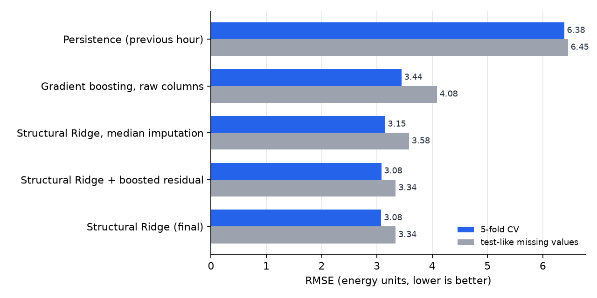
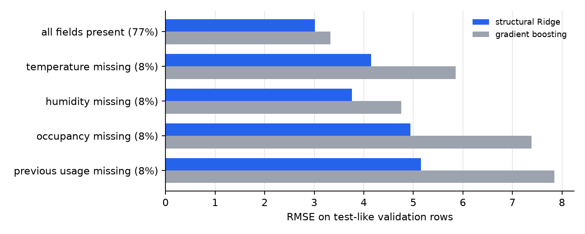

<h1 align="center">Campus Energy Forecasting</h1>

<p align="center"><b>Hourly energy use for 12 university buildings, predicted by a single structural Ridge regression that treats missing sensor readings as a modelling problem rather than a cleaning step. Finalist, NTU Datathon 2026 (Smart Campus Analytics track).</b></p>

<p align="center">
  <a href="https://github.com/DangKartik/campus-energy-forecasting/actions/workflows/tests.yml"></a>
  
  
  
  
</p>

**Topics:** regression · feature engineering · Fourier seasonality · regularisation · missing-data imputation · distribution shift · cross-validation design · model comparison · scikit-learn

The task: given a building, the hour, day and month, outdoor temperature and humidity, occupancy and the previous hour's usage, predict `energy_usage`, scored by RMSE. There are 8,000 labelled rows and 3,000 test rows. The catch is the missing data: each of the four measurements is missing in about **1.5%** of training rows but about **7%** of test rows, so a model that looks good in ordinary cross-validation can still fall apart on the test set.

<p align="center"></p>

## Key results

| | Result |
|---|---|
| **How accurate is it?** | 5-fold cross-validated RMSE **3.08** on a target with mean 51 and standard deviation 18, so a typical error is about 6% of usage. Under validation that copies the test set's missing values it is **3.34**. |
| **Against simpler models?** | Persistence (predict the previous hour) scores 6.38. Gradient boosting on the raw columns scores 3.44, and 4.08 once test-like gaps are added. |
| **What made the difference?** | Filling each missing measurement with a model trained on the other three plus building and calendar context, instead of a group median. That one change took the Ridge from **3.15 to 3.08** in plain CV and from **3.58 to 3.34** under test-like gaps. |
| **What did not help?** | A boosted-tree model fitted to the Ridge residuals (3.079 against 3.078). It was dropped, so the final model is a single linear regression with no ensemble. |
| **Where is it weakest?** | Rows missing occupancy or previous usage (RMSE 4.9 and 5.2), and Science buildings, which have the highest and most variable load (3.59). |

**Read this first.** The competition leaderboard score of our team's submission (public RMSE 3.14) came from an ensemble whose final blend weights were tuned against public-leaderboard feedback. That number is not reproduced or claimed here: this repository is the single, cross-validated model at the core of the approach, and every number above comes from `scripts/evaluate.py` on the training data. Its test predictions agree with the submitted ensemble to within an RMSE of 1.54 (correlation 0.997).

## Approach

**1. Validation that looks like the test set.** Plain K-fold validation sees almost no missing values. `campus_energy/validation.py` copies each validation fold three times and blanks fields using missingness patterns sampled from the test features (which fields are missing, never their values; no test labels exist). Every model choice was made on both scores.

**2. Context-aware imputation, fitted inside each fold.** For each of the four measurements, a small gradient-boosting regressor predicts it from the other three (left as missing when they are missing too) and from building, building type, day, hour and month. A 0/1 flag for every filled value goes into the model, so it can still discount an imputed reading.

**3. A structural linear model.** The Ridge design matrix (`campus_energy/features.py`) encodes what the data shows matters:

- building and building-type baselines, and day-of-week effects;
- daily (three Fourier pairs) and yearly (two pairs) cycles, plus a weekend flag;
- **per-building** copies of the daily cycle and of the slopes on temperature, humidity, occupancy and previous usage, because a library and a sports hall respond differently to the same crowd;
- hinge terms for very hot, cool and humid hours.

The regularisation strength barely matters between α = 0.3 and 3 (3.077 to 3.078); α = 3 is used. It degrades past α = 10.

<p align="center"></p>

Missing values cost the tree model far more than the structural model: with previous usage missing, RMSE is 5.2 for the Ridge against 7.9 for gradient boosting. The structural model degrades gracefully because the imputed value sits inside a basis that already knows the building's daily profile.

## Run it

```bash
python -m venv .venv && source .venv/bin/activate
pip install -e ".[dev]"
pytest -q                          # 10 tests on synthetic data, no download needed
```

The competition data is not redistributed here. Put `train.csv` and `test.csv` in `data/` ([data/README.md](data/README.md) has the schema), then:

```bash
python scripts/evaluate.py         # cross-validation, tables and figures in results/ (about 3 minutes)
python scripts/predict.py          # fits on all 8,000 rows, writes outputs/predictions.csv
```

## Repository layout

| Path | Contents |
|---|---|
| `campus_energy/features.py` | `ContextImputer` and the structural design matrix |
| `campus_energy/model.py` | `EnergyModel`: the structural Ridge, with the optional residual booster used in the comparison |
| `campus_energy/baselines.py` | persistence and gradient-boosting reference models |
| `campus_energy/validation.py` | cross-validation with test-like missing values |
| `scripts/` | `evaluate.py` (all results) and `predict.py` (submission file) |
| `results/` | `cv_results.csv`, error by missing field and by building type, `summary.json`, figures |
| `tests/` | imputation, feature and model tests on a synthetic campus |

## Limitations and what I would do next

- **Rows are independent snapshots.** There are no timestamps beyond hour and month, so lagged and rolling features (yesterday's usage at the same hour) cannot be built, and the folds cannot be split by time.
- **The test-like masks assume missingness is random given the pattern.** If sensors fail more often in particular buildings or conditions, the 3.34 estimate is optimistic.
- **The imputers are trained on 98.5%-complete data** and applied where fields are missing 7% of the time; a model trained with masked copies of the training rows would match the test conditions more closely.
- **Errors are not uniform.** Science buildings carry the largest error; a per-type variance model, or prediction intervals, would make that visible to whoever uses the forecast.

## Team

Built with my team, *Random guessing forest*, at the NTU Datathon 2026, where we were finalists in the Smart Campus Analytics track.

## License

[MIT](LICENSE)
